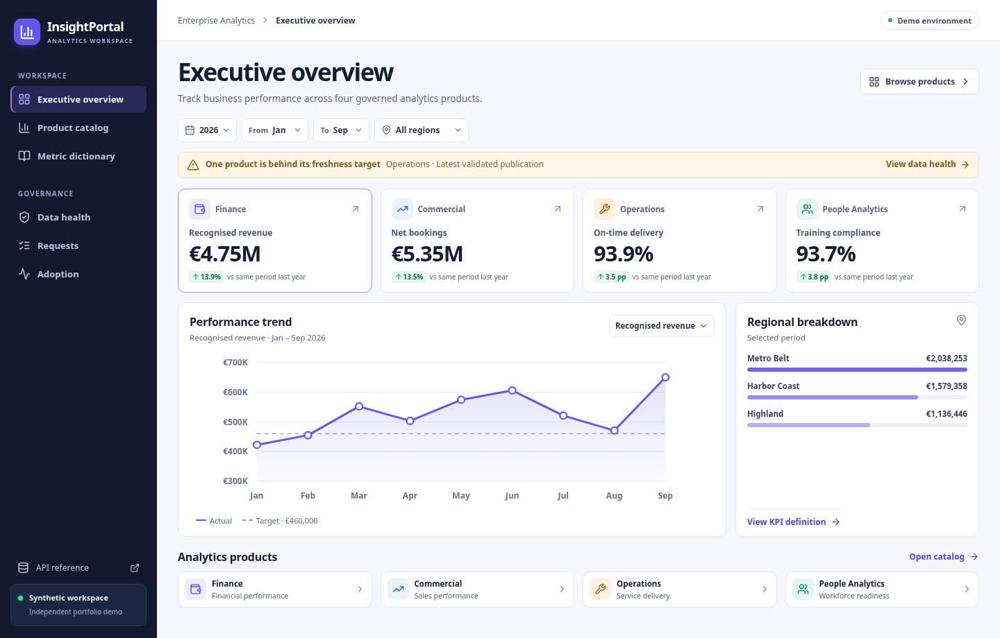
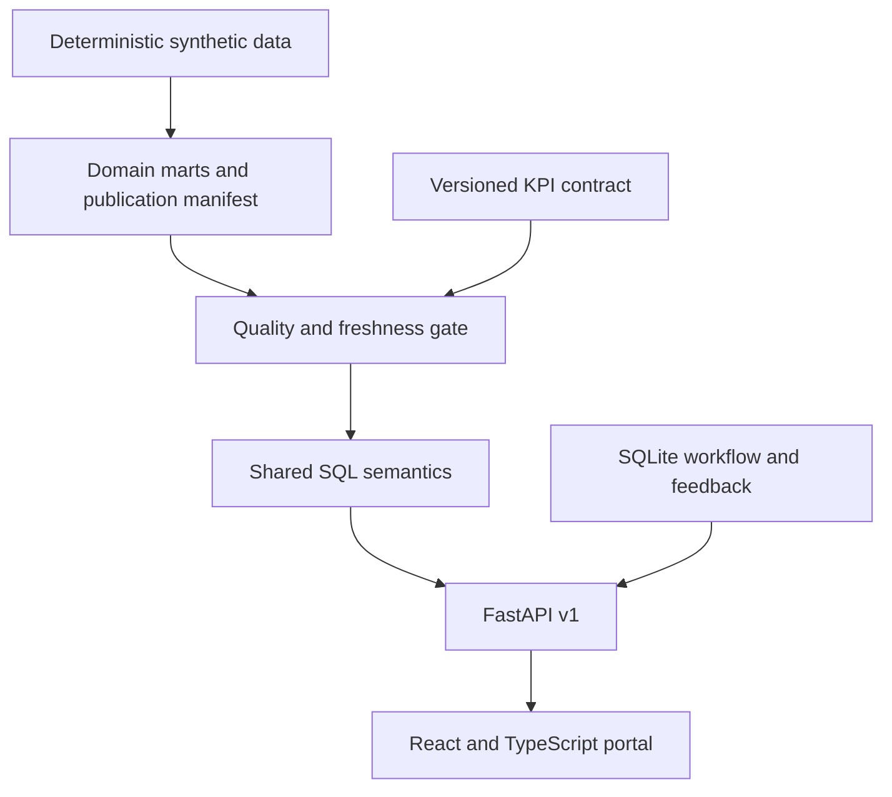

# InsightPortal

**Enterprise analytics products, governed KPIs and cross-functional delivery.**

InsightPortal is a functional portfolio demo for a fictional regional equipment-services network. Finance, Commercial, Operations and People Analytics publish eight shared KPIs, each with an accountable owner, a documented calculation and a release contract. Leaders can compare performance and drill into regions. The Product Owner can trace a request from intake through stakeholder acceptance and inspect adoption after a simulated release.



## Business decisions supported

| Department | Analytics product | Governed KPIs |
| --- | --- | --- |
| Finance | Financial performance | Recognised revenue and gross margin |
| Commercial | Sales performance | Net bookings and win rate |
| Operations | Service delivery | On-time delivery and completed visits |
| People Analytics | Workforce readiness | Training compliance and absence rate |

The executive view and domain dashboards share one semantic model. Finance and Commercial agree on month and region while retaining their own recognition and booking definitions. Operations can distinguish late data from a contract failure. People Analytics uses cohort aggregates at a declared release grain. The Product Owner ranks requests by impact, urgency and effort, then reviews acceptance with the relevant steward.

| Explore | What to inspect |
| --- | --- |
| [Product catalog](docs/assets/02-catalog.png) | Intended consumers, accountable owners and available dashboards |
| [Metric definition and lineage](docs/assets/03-metric-lineage.png) | Formulas, exclusions, goals and source-to-metric paths |
| [Data health](docs/assets/04-data-health.png) | Freshness SLA, contract checks and withheld results |
| [Request intake](docs/assets/05-requests.png) | Prioritisation, simulated independent review and decision history |
| [Adoption](docs/assets/06-adoption.png) | Eligible, active and returning users, satisfaction and local feedback |
| [Mobile overview](docs/assets/07-mobile.png) | Responsive navigation, KPI cards and monthly drill-down |

## Architecture



SQLite makes the full product runnable locally. A dedicated Snowflake schema can serve the same dimensional model and parameterised KPI queries. The [setup and parity procedure](docs/snowflake.md) requires a Snowflake test account. Local tests cover the reference model and remote-mode failure behaviour. Account-side parity is pending.

## Run locally

Requires **Python 3.12** and **Node.js 24**. Run from the project root.

```bash
python -m venv .venv
# macOS / Linux: source .venv/bin/activate
# Windows PowerShell: .venv\Scripts\Activate.ps1
python -m pip install -r requirements.txt
npm ci --prefix web
npm run build --prefix web
python -m uvicorn insightportal.main:app --host 127.0.0.1 --port 8000
```

Open [InsightPortal](http://127.0.0.1:8000) or the [OpenAPI reference](http://127.0.0.1:8000/docs). The first run creates databases under `runtime/`. Set `INSIGHTPORTAL_DATA_DIR` to a new directory to start from fresh fixtures while keeping existing workflow history.

With Docker Compose v2, run `docker compose up --build` and open the same address. A named volume persists intake and feedback across container restarts.

## Verify the increment

```bash
python -m pip install -r requirements-dev.txt
python -m pytest -q
python -m playwright install chromium
python scripts/browser_check.py
```

The API suite checks dimensional integrity, weighted ratios, prior-period comparisons, quality isolation, workflow concurrency and persistence. The Chromium walkthrough exercises keyboard drill-down, role-based simulation, ratings, source outage and recovery, and mobile navigation. Build the frontend before running the browser check. GitHub Actions is configured to run the API, frontend and browser checks and smoke-test Docker Compose.

## Product Ownership and design decisions

| Area | Where to start |
| --- | --- |
| Vision, discovery, stakeholder map and RACI | [Product brief](docs/product.md) |
| Roadmap, prioritisation, risks, releases and backlog | [Delivery plan](docs/delivery.md) · [Issue and milestone manifest](docs/backlog.json) |
| Serving contracts, lineage, quality and design decisions | [Architecture](docs/architecture.md) · [KPI contract](contracts/metrics.v1.json) |
| Stakeholder acceptance and evidence | [Walkthrough](docs/walkthrough.md) · [v1.0.0 release notes](docs/releases/v1.0.0.md) |

The workspace, data, adoption measures and stakeholder decisions are synthetic and independent. Reviewer selections simulate who approves an action. Keep the demo on localhost. The local and container instructions use that boundary.
