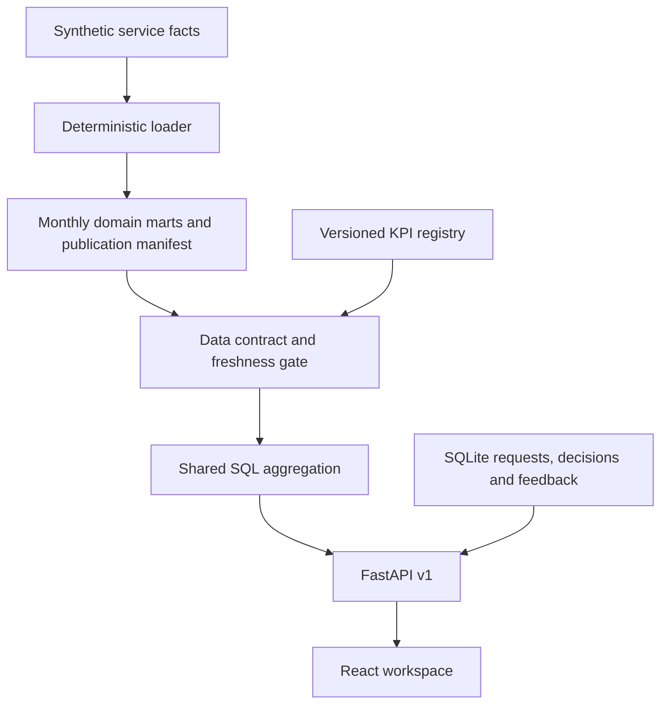

# Architecture and consumption contract

React and TypeScript serve a modular web workspace from one same-origin FastAPI application. SQLite provides full local execution and persistent workflow state. The analytical reader uses the same semantic queries against SQLite or a dedicated Snowflake schema. The demo keeps workflow writes separate from the warehouse reader. It uses no scheduler because the fixture is a fixed publication. Add orchestration when refresh dependencies and ownership are agreed.

## Model and lineage

Each fact table has one row per `(month, site_id)` and uses common calendar and service-region dimensions. The seed produces 63 region-month combinations per mart, across 21 months and three regions. The source labels refer to fictional registers generated at the serving grain. The loader builds both dimensions and four independent marts from a fixed seed. `publication` describes the version, latest published month and UTC publication timestamp for each domain. The dictionary maps a synthetic source to its serving table and metric definition.

| Marts | Measures at stored grain | Owner and consumer |
| --- | --- | --- |
| `mart_finance` | Recognised revenue and gross profit in integer cents | FP&A owns the close. Finance and executive leadership consume both KPIs. |
| `mart_commercial` | Bookings in integer cents, won opportunities and all closed opportunities | Sales Operations owns bookings and win rate for sales leaders and regional managers. |
| `mart_operations` | On-time and total completed service visits | Service Delivery owns throughput and reliability for dispatch and regional operations. |
| `mart_people` | Training-compliant people, eligible people, absence days and scheduled days as cohort aggregates | People Analytics owns policy and definitions for leaders and regional operations. |

A metric's identifier, columns, aggregation, scale, owner, definition, exclusions and goal live in the [contract](../contracts/metrics.v1.json). The API sums constituent quantities at the requested scope before dividing. Currency converts from cents after aggregation. Ratios with a zero denominator return `null`. Period changes are percentage points for rates and relative percentages for other metrics, against the same selected months in the prior year. Browser components format and navigate the same API values. Monthly organisation-wide goals are available only for the all-region selection. Rate targets apply across filters.

## Quality and publication rules

The service checks unique grain, dimension keys and definitions, full grid coverage, valid component values and publication metadata. When a structural check fails, the domain receives `blocked` and its metric series is omitted. It receives `late` when the validated publication misses its freshness target. The UI still shows that published data with a warning. Local analytical reads use one SQLite read transaction. Snowflake reads assume an immutable demo snapshot.

The scenario clock is fixed at 2 October 2026, 12:00 UTC. Operations intentionally exceeds its 12 h SLA. Production freshness requires real ingestion timestamps and alerting. The workforce demo stores aggregate inputs only and enforces a minimum 20 eligible people in each region-month. The threshold demonstrates a contract gate. Any release with real workforce data requires an independent disclosure review.

## API v1

| Endpoint | Inputs and semantics |
| --- | --- |
| `GET /api/v1/catalog` | Contract definitions, region dimension labels, published years and simulated actors |
| `GET /api/v1/dashboard` | `start`, `end` within one published calendar year, optional `site` and `domain`, repeated `metrics` keys. Returns freshness, quality check results, KPI totals, goal, prior period, month trend and region breakdown. |
| `GET /api/v1/requests` | Ranked request intake with decision history |
| `POST /api/v1/requests` | Validated request plus initial audit event |
| `POST /api/v1/requests/{id}/decisions` | Actor, action, rationale and expected row version. HTTP 409 on stale revision. |
| `GET /api/v1/adoption` | Fixed synthetic cohort results and separate local feedback aggregates |
| `POST /api/v1/adoption/feedback` | Upsert a rating by domain and simulated actor |

OpenAPI is served at `/docs`. An incompatible filter receives 422. An unavailable analytics source receives 503 with a generic error and an actionable retry. The demo never silently reads a second source. Local users can submit requests or ratings but cannot change semantic definitions through the application.

## Decisions

| Decision | Rationale and trade-off |
| --- | --- |
| ADR-01 · Shared SQL with a versioned registry | Prevents formula drift between executive and domain products. All formula changes require a reviewed contract update. |
| ADR-02 · Split read-only analytics from workflow state | Lets analytics point to Snowflake while keeping intake local. This requires two separate local databases in local mode. |
| ADR-03 · Domain-owned measures and centrally governed dimensions | Lets domain leads decide semantics while preserving comparability. Changing shared grain requires governance review across domains. |
| ADR-04 · Deliberate localhost boundary | Simulated actors demonstrate accountable decisions with version checks. Production use requires corporate identity, policy enforcement, operational controls and formal privacy review. |

A change to KPI meaning, grain or the same-period comparison is breaking. Keep the prior contract available during a migration, agree backwards-compatible adoption dates with consumers and test both versions with parity and reconciliation evidence. Adding a metric identifier is compatible when existing consumers ignore unknown entries.
